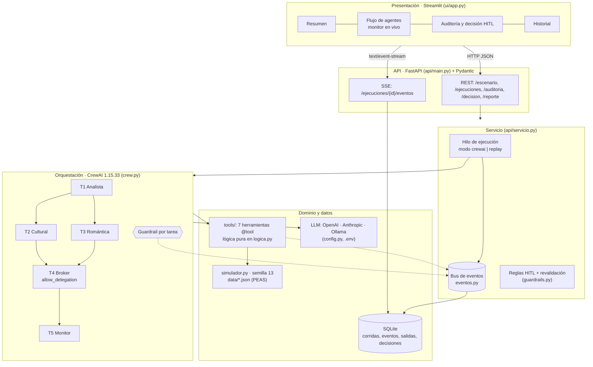
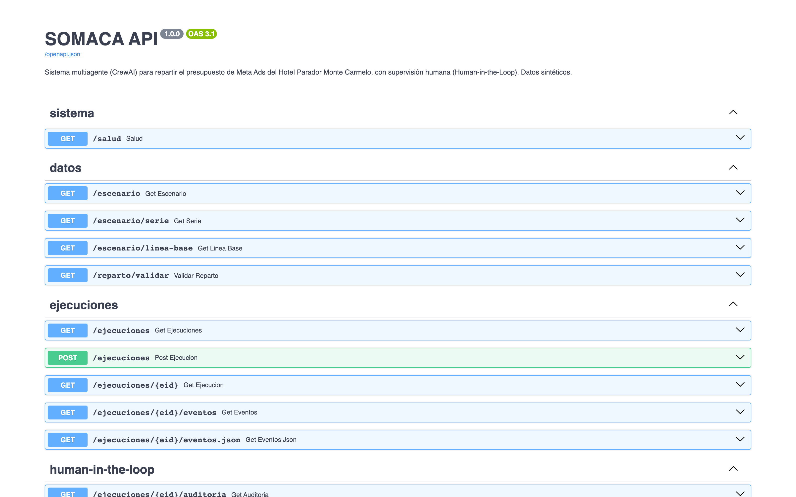
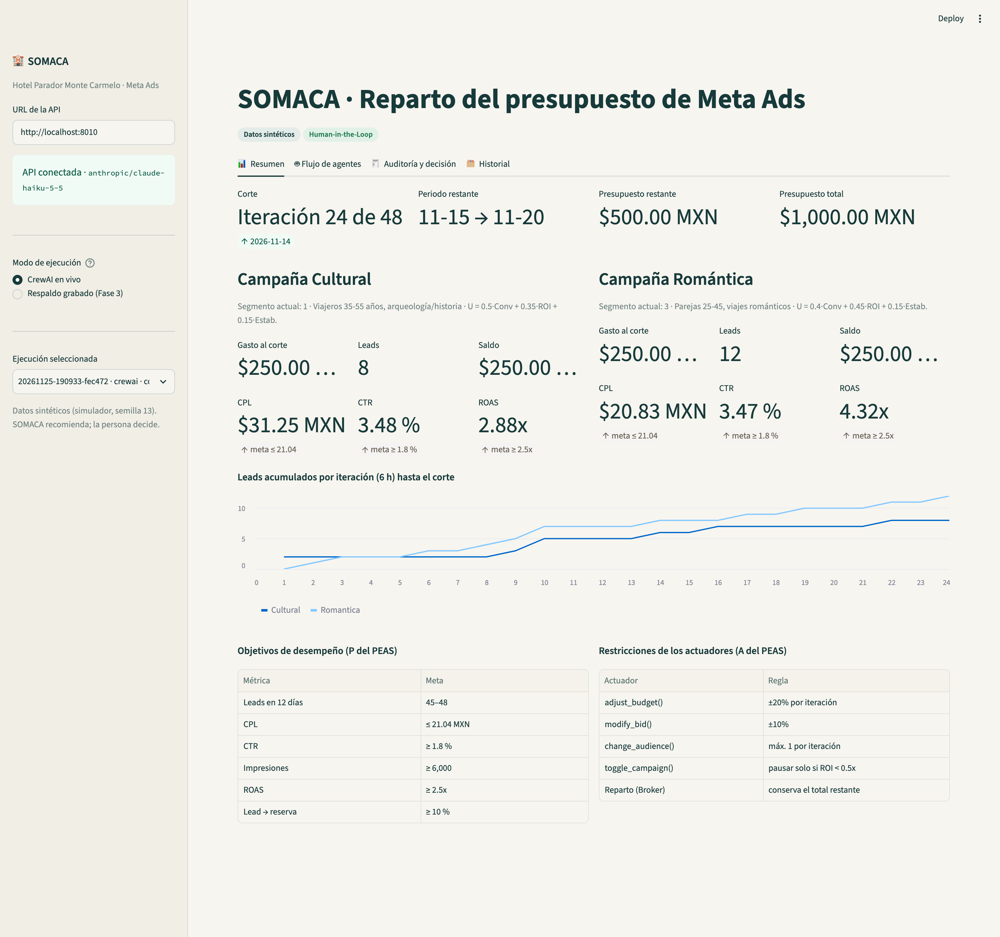
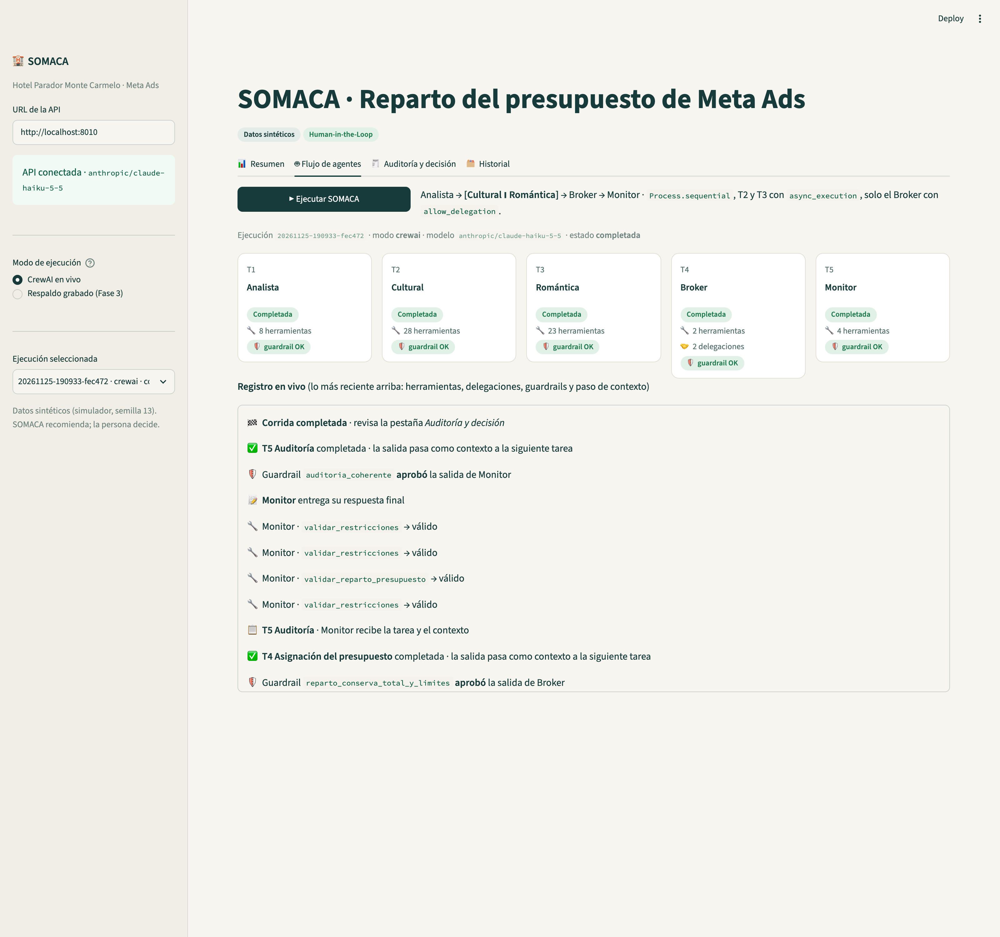
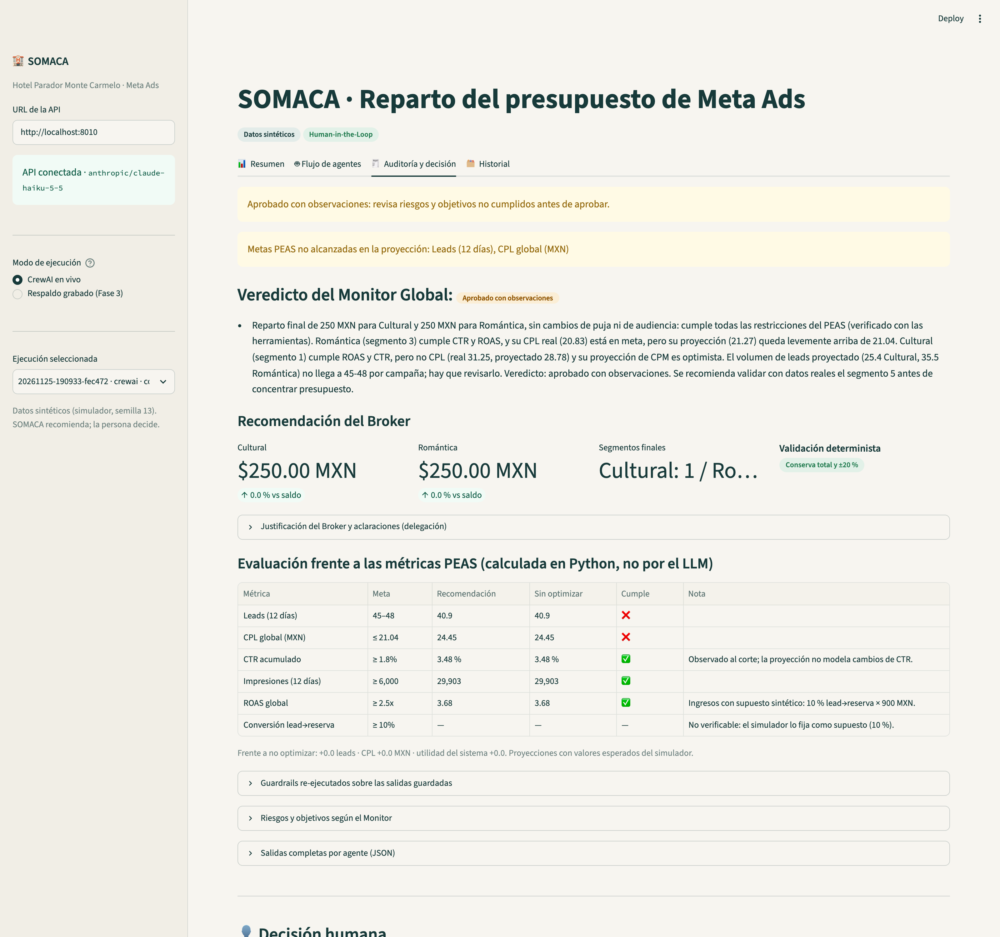
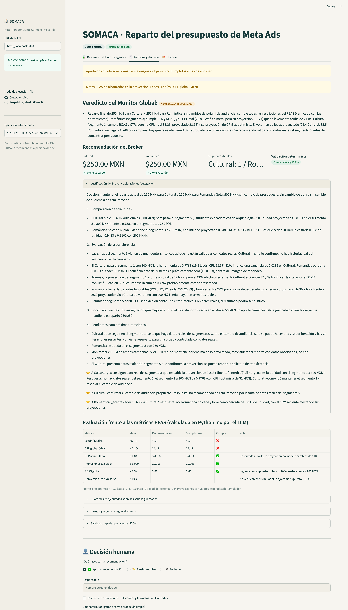
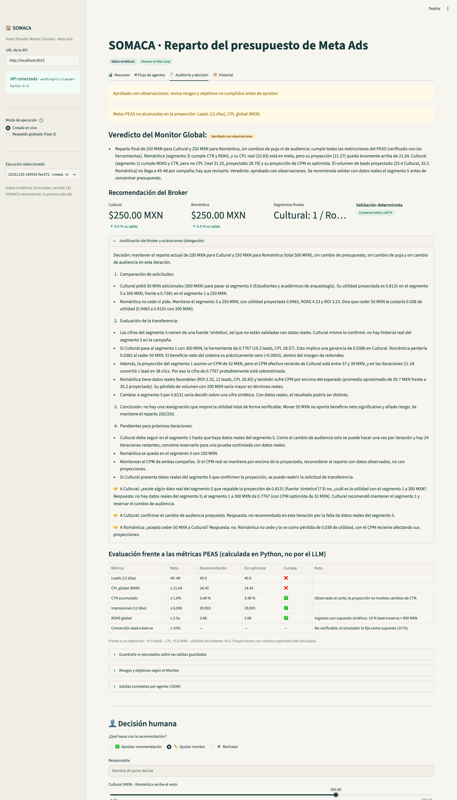
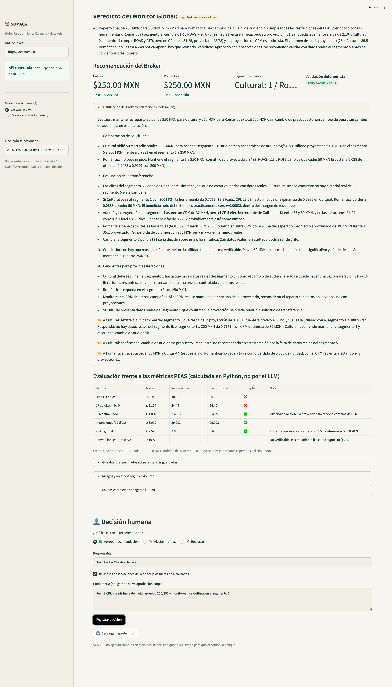
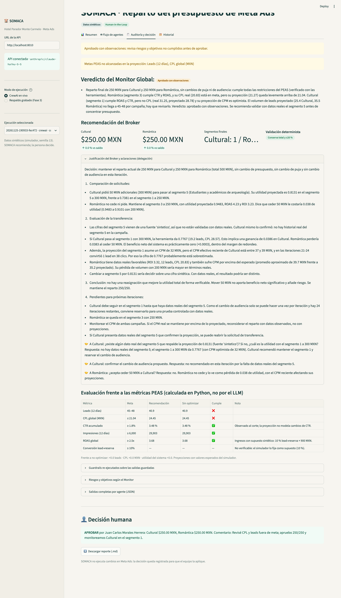
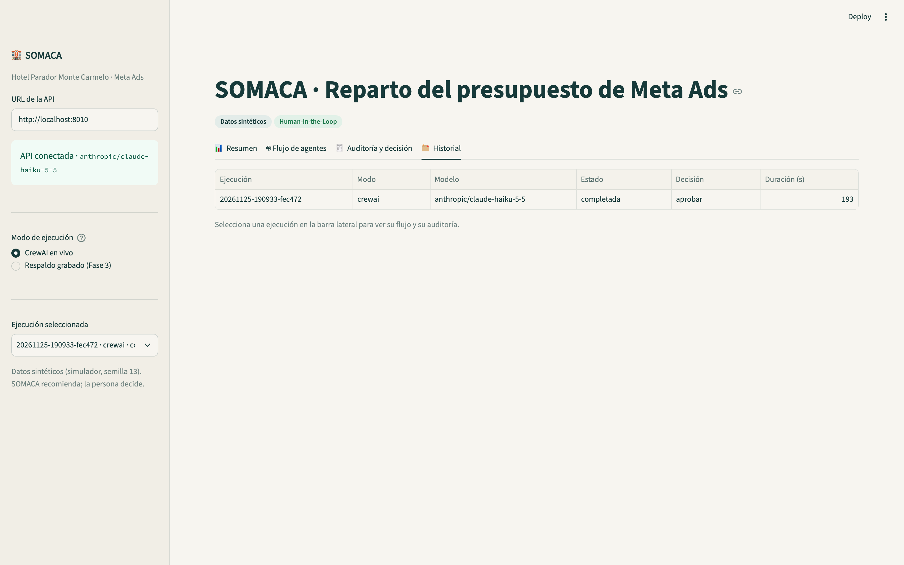

# SOMACA · Sistema Multiagente para campañas de Meta Ads

**Hotel Parador Monte Carmelo (Oaxaca)** · Proyecto final de Inteligencia Artificial · Maestría en Big Data e IA · Universidad Anáhuac Puebla · Equipo 8 · Otoño 2026

| Integrante | Matrícula | Rol |
|---|---|---|
| Juan Carlos Morales Herrera | 00630750 | Arquitecto de IA y desarrollador |
| Arantza Victoria Solano Alonso | 00367287 | Arquitecta de IA |
| Ingrid Orellán Hernández | 00617697 | Ingeniera de conocimiento |
| Víctor Luna Contreras | 00626847 | Ingeniero de conocimiento |

> **Datos sintéticos.** Todas las métricas provienen de un simulador de Meta Ads con semilla fija. SOMACA **recomienda**; una persona **decide**. El sistema no escribe nada en Meta Ads.

---

## 1. Descripción y arquitectura

### 1.1 Resumen ejecutivo

El hotel invierte **1,000 MXN en 12 días** en dos campañas de Meta Ads con objetivos que compiten: **Cultural** (prioriza leads) y **Romántica** (prioriza ROI). A mitad de la campaña (iteración 24 de 48, 14-nov-2026) quedan **500 MXN** por repartir. Hacerlo a mano es lento, no comparte aprendizaje entre campañas y no deja rastro de por qué se decidió.

SOMACA resuelve esa decisión con **5 agentes de CrewAI** especializados (Analista, Cultural, Romántica, Broker y Monitor), **7 herramientas deterministas** en Python, **guardrails** que revisan cada salida del LLM y un **dashboard Human-in-the-Loop** donde el responsable de marketing audita la recomendación y la aprueba, la ajusta o la rechaza.

### 1.2 Diagrama de componentes por capas



**Comunicación asíncrona.** `POST /ejecuciones` responde `202 Accepted` con un identificador y el Crew corre en un hilo. Cada herramienta, paso de agente, delegación, guardrail y tarea completada se publica en el bus de eventos, se guarda en SQLite y se transmite a la GUI por **Server-Sent Events** (con reconexión por `Last-Event-ID`). La GUI nunca calcula reglas: todo lo valida el servidor.

### 1.3 Especificación PEAS (agente de campaña)

| | Especificación | Dónde vive en el código |
|---|---|---|
| **P · Desempeño** | U = w₁·Conversiones + w₂·ROI + w₃·Estabilidad (Cultural 0.50/0.35/0.15; Romántica 0.40/0.45/0.15). Metas a 12 días: 45–48 leads, CPL ≤ 21.04 MXN, CTR ≥ 1.8 %, ≥ 6,000 impresiones, ROAS ≥ 2.5x, lead→reserva ≥ 10 % | `data/pesos_utilidad.json`, `data/restricciones_objetivos.json`, `calcular_utilidad`, `escenario.evaluar_peas` |
| **E · Entorno** | Mercado de Meta Ads en Oaxaca: 10 segmentos de audiencia, CPM por período (laboral, fin de semana +20 %, temporada alta +40 %, eventos +50 %) | `data/inventario_audiencias.json`, `data/cpm_estacionalidad.json`, `simulador.py` |
| **A · Actuadores** | `adjust_budget` ±20 %, `modify_bid` ±10 %, `change_audience` 1 por iteración, `toggle_campaign` solo si ROI < 0.5x; `request_budget` / `yield_budget` al Broker | `validar_restricciones`, `validar_reparto_presupuesto`, delegación del Broker |
| **S · Sensores** | CTR, CPC, conversiones, presupuesto disponible, impresiones (cada 6 h); CPM de mercado, día de la semana, iteración | `leer_metricas_campana`, `consultar_cpm_mercado`, `leer_inventario_audiencias` |

**Propiedades del entorno:** parcialmente observable · no determinista · dinámico · discreto (iteraciones de 6 h) · multiagente cooperativo-competitivo.

### 1.4 Agentes y tareas

| Agente (`role`) | Herramientas | Delega | Tarea | Guardrail determinista |
|---|---|---|---|---|
| Analista de Mercado de Meta Ads | `consultar_cpm_mercado`, `leer_inventario_audiencias` | No | T1 Análisis de mercado | JSON válido; 2 segmentos por campaña **que existan** en el inventario |
| Agente de Campaña Cultural | `leer_metricas_campana`, `leer_inventario_audiencias`, `proyectar_escenario`, `calcular_utilidad`, `validar_restricciones` | No | T2 Propuesta (async) | Segmento propio, monto en [0, restante], solicitud ∈ {pedir, ceder, mantener} |
| Agente de Campaña Romántica | (las mismas cinco) | No | T3 Propuesta (async) | Igual que T2 |
| Broker de Presupuesto | `calcular_utilidad`, `proyectar_escenario`, `validar_reparto_presupuesto` | **Sí** | T4 Asignación | El reparto **conserva el total** y ninguna campaña cambia más de ±20 % (se recalcula en Python) |
| Monitor Global de Cumplimiento | `validar_restricciones`, `validar_reparto_presupuesto` | No | T5 Auditoría | Veredicto ∈ {aprobado, aprobado_con_observaciones, rechazado}; no puede afirmar cumplimiento si la validación determinista falla |

Si un guardrail falla, CrewAI devuelve el error al agente y este reintenta (`guardrail_max_retries=2`).

### 1.5 Estructura del repositorio

| Ruta | Contenido |
|---|---|
| `agents.py`, `tasks.py`, `crew.py` | Agentes, tareas (con guardrails) y ensamble del Crew con callbacks de observabilidad |
| `guardrails.py` | Guardrails deterministas y reglas del lazo humano (sin dependencia de CrewAI) |
| `escenario.py` | Entradas del caso, vista Resumen, línea base y evaluación PEAS determinista |
| `eventos.py` | Bus de eventos para el monitor en vivo |
| `tools/` | `logica.py` (funciones puras) y `herramientas.py` (envoltorios `@tool`) |
| `simulador.py`, `data/` | Simulador de Meta Ads (semilla 13) y datos del dominio del PEAS |
| `api/` | `main.py` (rutas FastAPI) y `servicio.py` (SQLite, ejecución, SSE, auditoría, HITL) |
| `ui/` | `app.py` (Streamlit), `cliente.py` (REST + SSE), `formato.py` |
| `data/demo/corrida_grabada.json` | Respaldo de la demo: corrida real de la Fase 3 en formato de eventos |
| `scripts/generar_replay.py` | Regenera el respaldo a partir de `logs/corrida.log.txt` |
| `scripts/demo_local.sh`, `scripts/capturas.py` | Despliegue local en un comando y capturas automáticas con Playwright |
| `docs/capturas/` | Capturas de la corrida final |
| `logs/` | Log, respuesta final y consumo de tokens de la corrida de la Fase 3 |
| `docs/` | Supuestos de datos y guion de la demostración en vivo |
| `tests/` | 40 pruebas: simulador (7), herramientas (7), guardrails (13), servicio (8), API (2) y Crew (3) |
| `main.py` | Ejecución por consola (sin GUI) |

---

## Capturas de la corrida final

Corrida real del **25-nov-2026** con `anthropic/claude-haiku-5-5` (semilla 13): **193 s**, 65 llamadas a herramientas atribuidas a su agente, 2 delegaciones del Broker, 5/5 guardrails aprobados. Veredicto del Monitor: **aprobado con observaciones**. Decisión humana: **aprobar 250/250** (Cultural se queda en el segmento 1 por falta de datos reales del segmento 5). Capturas generadas con `python scripts/capturas.py --existente`.

| | |
|---|---|
|  **API FastAPI** (OpenAPI en `/docs`) |  **Resumen**: sensores al corte, metas y restricciones del PEAS |
|  **Flujo de agentes**: 5 etapas, herramientas por agente, delegaciones y guardrails |  **Auditoría**: alertas, veredicto del Monitor y reparto del Broker |
|  **Delegación y PEAS**: aclaraciones del Broker y evaluación en Python |  **HITL**: ajuste manual a 350 MXN (fuera de ±20 %) |
|  **HITL**: aprobación con observaciones reconocidas |  **Decisión registrada** con responsable y comentario |
|  **Historial** de corridas y decisiones | |

---

## 2. Prerrequisitos de software

- **Python 3.11 o 3.12** (recomendado 3.12).
- Dependencias en [`requirements.txt`](requirements.txt): `crewai[anthropic]==1.15.33`, `fastapi`, `uvicorn`, `streamlit`, `pandas`, `numpy`, `requests`, `python-dotenv`, `pytest`, `httpx`.
- Una llave de API de **OpenAI** (o de Anthropic) **u** Ollama instalado localmente. Sin llave, el sistema funciona en **modo respaldo**.
- Plantilla de variables de entorno: [`.env.example`](.env.example).

| Variable | Uso | Valor por defecto |
|---|---|---|
| `MODEL` | Modelo en formato `proveedor/modelo` | `openai/gpt-5.4-mini` |
| `OPENAI_API_KEY` / `ANTHROPIC_API_KEY` | Llave del proveedor elegido | — |
| `OLLAMA_BASE_URL` | Servidor de Ollama | `http://localhost:11434` |
| `SIM_SEED` | Semilla del simulador | `13` |
| `SOMACA_DB` | Base SQLite de corridas y decisiones | `data/somaca.db` |
| `SOMACA_API` | URL de la API para la GUI | `http://localhost:8000` |
| `REPLAY_VELOCIDAD` | Velocidad del modo respaldo | `1.0` |

---

## 3. Guía de instalación y despliegue

### 3.1 Clonar e instalar

```bash
git clone https://github.com/jcarlosmhmx/somaca-crewai.git
cd somaca-crewai
python3.12 -m venv .venv
source .venv/bin/activate            # Windows: .venv\Scripts\activate
pip install -r requirements.txt
cp .env.example .env                 # Windows: copy .env.example .env
```

### 3.2 Configurar el LLM (elige una opción en `.env`)

**OpenAI (recomendado para la demo):**
```ini
MODEL=openai/gpt-5.4-mini
OPENAI_API_KEY=sk-...
```
**Anthropic (modelo de la corrida de la Fase 3):**
```ini
MODEL=anthropic/claude-haiku-5-5
ANTHROPIC_API_KEY=sk-ant-...
```
**Ollama (local, sin costo; más lento):**
```bash
ollama pull llama3.1 && ollama serve
```
```ini
MODEL=ollama/llama3.1
OLLAMA_BASE_URL=http://localhost:11434
```

### 3.3 Iniciar la API y la interfaz (dos terminales, desde la raíz del repo)

```bash
# Terminal 1 · API (documentación OpenAPI en http://localhost:8000/docs)
uvicorn api.main:app --port 8000

# Terminal 2 · GUI (se abre en http://localhost:8501)
streamlit run ui/app.py
```

Verificación rápida: `curl http://localhost:8000/salud` debe responder `"ok": true` y `"llave_configurada": true`.

**Todo en un comando** (instala, corre pruebas, levanta API en 8010 y GUI en 8510, hace una corrida y toma capturas):
```bash
bash scripts/demo_local.sh            # corrida real con el LLM de .env
bash scripts/demo_local.sh --replay   # modo respaldo, sin LLM
```
Si los puertos 8000/8501 ya los usa otro proyecto, levanta la API con `--port 8010` y la GUI con `SOMACA_API=http://localhost:8010 streamlit run ui/app.py --server.port 8510`.

### 3.4 Endpoints

| Método y ruta | Descripción |
|---|---|
| `GET /salud` | Estado, modelo configurado y si hay una corrida activa |
| `GET /escenario`, `/escenario/serie`, `/escenario/linea-base` | Sensores al corte, serie por iteración y proyección sin optimizar |
| `GET /reparto/validar?cultural=&romantica=` | Vista previa de la validación determinista de un reparto |
| `POST /ejecuciones` `{"modo": "crewai" \| "replay"}` | Lanza el Crew (202 + id; 409 si ya hay una activa) |
| `GET /ejecuciones`, `/ejecuciones/{id}` | Historial y estado por etapa |
| `GET /ejecuciones/{id}/eventos` | **SSE** con cada herramienta, delegación, guardrail y tarea |
| `GET /ejecuciones/{id}/auditoria` | Salidas, guardrails re-ejecutados, validación, evaluación PEAS y alertas de veto |
| `POST /ejecuciones/{id}/decision` | Decisión humana: `aprobar`, `ajustar` o `rechazar` (el servidor revalida; 422 si viola reglas) |
| `GET /ejecuciones/{id}/reporte` | Reporte Markdown descargable |

---

## 4. Instrucciones de reproducción

### 4.1 Conjunto de datos sintéticos

| Archivo | Contenido | Origen |
|---|---|---|
| `data/restricciones_objetivos.json` | Presupuesto (1,000 MXN, 500/500), 12 días × 4 iteraciones, corte en la 24, metas y restricciones | PEAS C.1 y C.3 |
| `data/pesos_utilidad.json` | Pesos w₁, w₂, w₃ por campaña | PEAS C.1 |
| `data/inventario_audiencias.json` | 10 segmentos (1–4 del PEAS, 5–10 sintéticos) | PEAS C.2 + supuestos |
| `data/cpm_estacionalidad.json` | CPM por período | PEAS C.2 |
| `data/metricas_simuladas.csv` | 96 filas (48 iteraciones × 2 campañas) generadas con semilla 13 | `python simulador.py` |
| `data/demo/corrida_grabada.json` | Corrida real de la Fase 3 en eventos (respaldo de la demo) | `python scripts/generar_replay.py` |

Supuestos y su justificación: [`docs/supuestos_datos.md`](docs/supuestos_datos.md).

### 4.2 Comandos exactos

```bash
# 1. Pruebas automáticas (no llaman al LLM): simulador, herramientas, guardrails, servicio, API y Crew
python -m pytest -q

# 2. Regenerar los datos sintéticos (mismo resultado con SIM_SEED=13)
python simulador.py

# 3a. Corrida por consola, sin GUI (usa el LLM de .env)
python main.py

# 3b. Corrida completa con GUI: iniciar API y Streamlit (sección 3.3) y pulsar «Ejecutar SOMACA»

# 3c. Sin llave o sin internet: misma GUI en modo respaldo
curl -X POST localhost:8000/ejecuciones -H "Content-Type: application/json" -d '{"modo":"replay"}'
```

### 4.3 Caso de prueba de la demostración en vivo

- **Entrada:** corte en la iteración 24 (14-nov-2026), 500 MXN restantes para el 15–20 de noviembre, semilla 13.
- **Estado al corte:** Cultural 8 leads, CPL 31.25 MXN, ROAS 2.88x (segmento 1). Romántica 12 leads, CPL 20.83 MXN, ROAS 4.32x (segmento 3).
- **Línea base (sin optimizar, 250/250 en los mismos segmentos):** 40.9 leads proyectados, CPL global 24.45 MXN.
- **Resultado de referencia (corrida de la Fase 3):** reparto 250/250, Cultural pasa al segmento 5; 42.4 leads proyectados, CPL 23.58 MXN, ROAS 3.81x; veredicto **aprobado con observaciones** (cumple CTR, impresiones y ROAS; no cumple leads ni CPL).
- **Corrida final (25-nov-2026, GUI):** reparto 250/250 sin cambio de segmento (Cultural pidió pasar al 5, el Broker lo rechazó por ser una proyección sintética). Proyección igual a la línea base: 40.9 leads, CPL 24.45 MXN; veredicto aprobado con observaciones; decisión humana: aprobar.
- Las respuestas del LLM varían entre corridas (en la Fase 3 hubo 300/200 y 250/250). Lo reproducible son las **reglas**: todo reparto aceptado conserva el total, respeta ±20 % y pasa los guardrails.

Guion minuto a minuto: [`docs/guion_demo.md`](docs/guion_demo.md).

### 4.4 Costo y tiempo de una corrida

La corrida de la Fase 3 tardó **≈ 3 minutos** e hizo 135 solicitudes al LLM (1.2 M tokens, ≈ US$0.22 con Claude Haiku 5.5; ver `logs/uso_tokens.txt`). Con OpenAI el costo depende del modelo elegido en `.env`.

---

## 5. Limitaciones y trabajo futuro

- Datos sintéticos: los segmentos 5–10, el CTR base y el ingreso por reserva son supuestos.
- La proyección usa valores esperados y no modela cambios de CTR; puede ser optimista frente al CPM real reciente.
- Se ejecuta una corrida a la vez y el reparto final aún se aplica a mano en Meta Ads.
- Siguiente paso: lectura de métricas con la Meta Marketing API (solo lectura), PostgreSQL y una cola de trabajos (Celery/Redis), múltiples corridas para medir la consistencia de las recomendaciones, y más de dos campañas.

## Licencia y uso académico

Proyecto académico de la Universidad Anáhuac Puebla. Los datos del hotel son ilustrativos y sintéticos.
